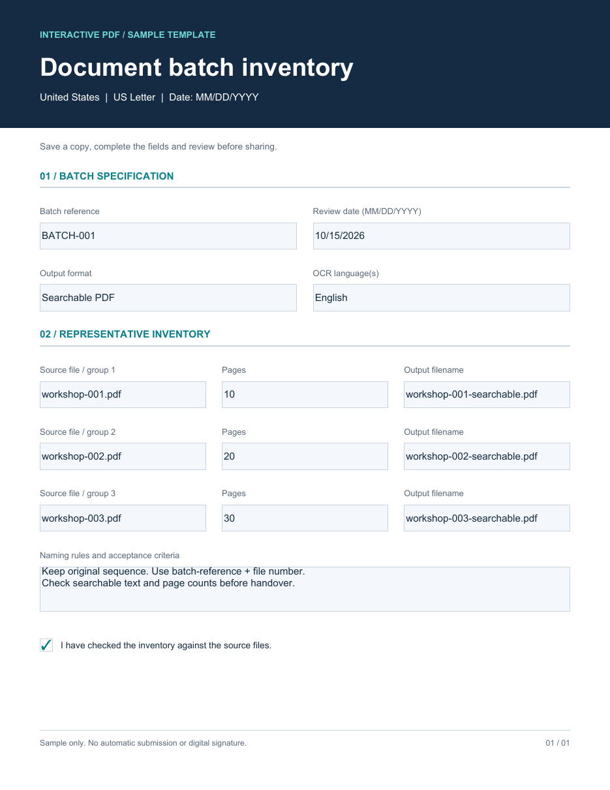

# Document Conversion Service Toolkit

Plan a mixed-format batch with an inventory, output specification and acceptance criteria. Explore unbranded sample screenshots and practical guidance for projects in the United States, United Kingdom and Australia.

## Sample screenshots

| Country | Paper and date convention shown | Blank form screenshot | Completed example screenshot |
|---|---|---|---|
| United States | Letter; MM/DD/YYYY | [View blank US sample](inventory-us-blank.png) | [View completed US sample](inventory-us-filled.png) |
| United Kingdom | A4; DD/MM/YYYY | [View blank UK sample](inventory-uk-blank.png) | [View completed UK sample](inventory-uk-filled.png) |
| Australia | A4; DD/MM/YYYY | [View blank Australian sample](inventory-au-blank.png) | [View completed Australian sample](inventory-au-filled.png) |

The samples contain no company name or logo. Names and entries are fictional. The gallery contains static screenshots for reference.

## How to use these examples

Use the screenshots to plan a mixed-format batch, including filenames, page counts, output format, OCR language and acceptance criteria. The CSV manifest provides a larger inventory example.

## What is included

- Six screenshots showing blank and completed examples across three country variants.
- [Usage and quality guide](USAGE.md), [country notes](COUNTRIES.md) and [search intent map](SEARCH-INTENT.md).
- Field descriptions and preparation validation notes for the pictured forms.
- A [sample CSV batch manifest](batch-manifest.csv) with fictional file references.

## Need a custom version?

For project-specific work, see [document conversion service](https://pdfserviceexperts.com/services/document-conversion-services/). Include your source format, approximate volume and desired output when asking for a quote.

## About the previews

The PNGs were rendered from the original sample PDFs during preparation. The current repository publishes screenshots and supporting content. It does not distribute downloadable PDF forms or Python generator files. The examples have not been audited for PDF/UA, WCAG or jurisdiction-specific compliance.

## License

Original screenshots and documentation are provided under the [MIT License](LICENSE). External websites retain their own terms and branding.
